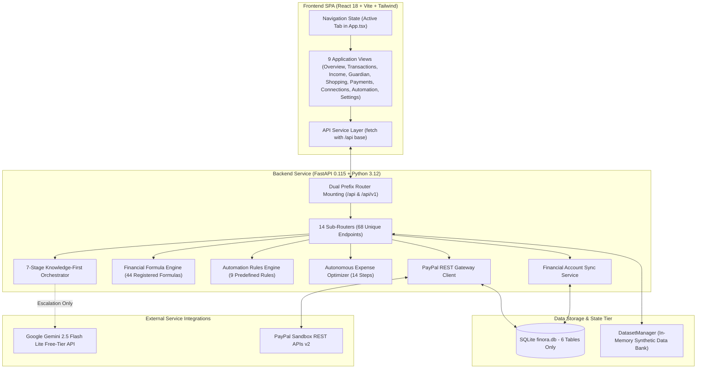

# FINORA — Technical Architecture & System Quality Audit

**Date of Audit:** 2026-11-10  
**Project Location:** `D:\FINORA`  
**Auditor:** Antigravity Independent Verification Engine  

---

## 1. System Architecture Overview

FINORA is structured as a decoupled web application comprising a FastAPI backend and a React (Vite) single-page application.

---

## 2. Frontend Architecture & Technical Assessment

### 2.1. Routing & State Management
- **No Client-Side Router:** The application does not use `react-router-dom`. Navigation between the 9 views (`overview`, `transactions`, `income`, `guardian`, `shopping`, `payments`, `connections`, `automation`, `settings`) is controlled by a single `activeTab` React state variable in `App.tsx`.
- **State Scope:** State is primarily local to individual page components, with shared user ID (`activeUserId = "usr_alex_chen"`) and scenario selection passed down via props.
- **Data Fetching:** Direct `fetch()` calls wrapped in `frontend/src/services/api.ts`. No caching library (e.g. React Query / SWR / Redux Toolkit).

### 2.2. Build Quality & Bundle Analysis
- **Build System:** Vite 5.4.21 with `@vitejs/plugin-react` and TypeScript 5.5.
- **Production Compilation:** `npm run build` compiles cleanly in **6.10s** with 0 errors.
- **Bundle Weight:**
  - `dist/index.html`: 1.16 kB
  - `dist/assets/index-Cn-SMCe_.css`: 29.83 kB
  - `dist/assets/index-1UfyhMKC.js`: 703.85 kB (exceeds 500 kB chunk warning due to Lucide icon set and charting components).
- **Code Hygiene:** Clean Tailwind CSS utility classes; responsive layout (collapsible sidebar, grid layouts).

---

## 3. Backend Architecture & API Design

### 3.1. Routing & Mounting Architecture
- **Dual Prefix Mounting:** `backend/app/main.py` mounts all 14 routers under both `settings.API_V1_STR` (`/api`) and `/api/v1` to ensure backward compatibility across frontend fetch targets.
- **Total Registered Endpoints:** **68 unique endpoints** (136 mounted endpoints + root `/` + `/health`).
- **Input Validation:** Strict Pydantic models on request bodies and query parameters across all endpoints.

### 3.2. Disconnected Data Storage Architecture
A major architectural anomaly exists between database storage and application state:
1. **SQLite Database (`finora.db`):** Contains ONLY 6 tables:
   - `captured_payments` (36 rows)
   - `paypal_orders` (32 rows)
   - `connected_accounts` (16 rows)
   - `sync_logs` (28 rows)
   - `user_preferences` (0 rows)
   - `paypal_webhooks` (19 rows)
2. **In-Memory Data Bank (`DatasetManager`):** The core financial entities—`users`, `accounts`, `transactions`, `merchants`, `subscriptions`, `products`, `businesses`, `invoices`, and `activity_evidence`—are generated and stored purely in Python memory.
3. **Consequence:** If the FastAPI backend restarts, newly created or modified financial transactions, budgets, or subscriptions are reset to the initial seed (unless explicitly exported/imported via JSON endpoints).

---

## 4. AI & Knowledge Architecture

### 4.1. Seven-Stage Knowledge-First Pipeline (`KnowledgeOrchestrator`)
FINORA's core reasoning engine prioritizes internal determinism over AI APIs:
1. **Stage 1 (Intent & Entity Parsing):** Regex and keyword intent classifier maps prompts to domain intents (`KNOWLEDGE_LOOKUP`, `SUBSCRIPTION_AUDIT`, `PURCHASE_AFFORDABILITY`, `LOAN_AMORTIZATION`, etc.).
2. **Stage 2 (Internal Knowledge Retrieval):** Searches `KnowledgeRepository` (16 curated entries across Personal Finance, Accounting, and Consumer Commerce).
3. **Stage 3 (Deterministic Algorithm Execution):** Calls exact Decimal math algorithms or formula registry implementations.
4. **Stage 4 (Knowledge Sufficiency Assessment):** Evaluates if internal data satisfies the user query (`SUFFICIENT`, `PARTIALLY_SUFFICIENT`, `INSUFFICIENT`).
5. **Stage 5 (Escalation Gate):** If sufficient, returns immediate verified calculation; if insufficient, escalates to AI.
6. **Stage 6 (AI Escalation):** Calls Google Gemini 2.5 Flash Lite (free-tier, 0-cost enforced) with structured factual grounding.
7. **Stage 7 (Validation & Verification):** Strips hallucinations; asserts output consistency.

---

## 5. Calculation, Formula & Automation Engines

### 5.1. Formula Registry (`FinancialFormulaRegistry`)
- **Inventory:** 44 registered financial formulas spanning 12 domains.
- **Execution Status:** 42 executable and tested, 1 reference-only, 1 requiring external market data.
- **Precision:** Implemented exclusively using Python's `Decimal` module with `ROUND_HALF_UP` rounding.

### 5.2. Automation Rules Engine (`AutomationEngine`)
- **Inventory:** 9 predefined rules (unusual spend alert, duplicate charge watch, renewal monitor, low usage optimizer, emergency floor watch, debt early payoff eval, fraud anomaly watch, health reforecast, income deposit tracker).
- **Execution Mode:** Rules evaluate synchronously when event triggers are dispatched. No independent background Celery or Redis worker queue exists.
- **Safety Gate:** Actions classified into 4 permission tiers. High-consequence actions (e.g. cancellations, transfers) require explicit user approval.

---

## 6. Technical Debt & Architectural Contradictions

| # | Technical Problem | Root Cause | Impact |
| :--- | :--- | :--- | :--- |
| **TD.1** | In-Memory Core Entities vs SQLite Hybrid | Core entities generated in memory; only payments & sync logged to SQLite. | Data loss upon server restart; cannot scale horizontally. |
| **TD.2** | Merchant Gateway vs Personal Finance Integration | Implemented PayPal merchant checkout (`/v2/checkout/orders`) instead of personal wallet aggregation. | Cannot read personal consumer transactions or balances. |
| **TD.3** | Zero User Authentication & Tenant Isolation | No auth middleware; `user_id` is an unverified request parameter. | Critical vulnerability: cross-user data access and action execution. |
| **TD.4** | Concurrency Race Condition on Payment Capture | Capture checking checks in-memory dictionary before asynchronous network call finishes. | Concurrent requests bypass duplicate prevention (`10 COMPLETED, 0 BLOCKED`). |
| **TD.5** | Simulated Open Banking Sync | `sync_service.py` simulates Plaid/TrueLayer without real SDKs or OAuth flows. | Cannot aggregate live consumer bank accounts. |
| **TD.6** | Static Mock Location & Business Discovery | Location is hardcoded in memory (San Francisco); candidates are static list of 3 gyms. | Cannot perform real GPS context awareness or live local discovery. |
| **TD.7** | Absence of Background Daemon Process | No task queue (Celery/APScheduler); scheduled rules evaluate only on HTTP triggers. | Alerts and monitoring do not fire proactively while the user is offline. |
| **TD.8** | Unbounded Sensitive Data Retention | `CapturedPayment` and `PayPalWebhookRecord` store unredacted raw gateway JSON and cleartext emails. | Violates data privacy standards (GDPR/CCPA/PCI DSS). |
| **TD.9** | Lack of Client-Side URL Routing | Tab navigation in React state (`App.tsx`) rather than HTML5 History API (`react-router-dom`). | Cannot deep-link, bookmark, or use browser back/forward buttons. |
| **TD.10**| Monolithic Frontend Bundle | Vite output generates a single 703 kB JS chunk without dynamic `import()` code-splitting. | Slower initial page load on mobile networks. |
