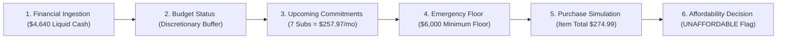
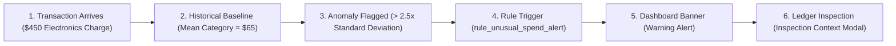
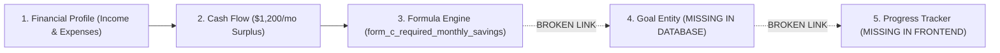
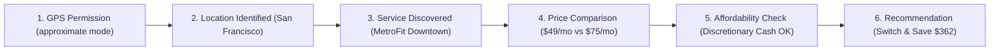

# FINORA — Cross-Module Intelligence Workflow Audit

**Date of Audit:** 2026-11-10  
**Project Location:** `D:\FINORA`  
**Auditor:** Antigravity Independent Verification Engine  

---

## 1. Executive Summary

A core requirement of FINORA is cross-module intelligence: modules must not function as disconnected silos, but must share financial context, telemetry, and calculations across workflows.

Six primary multi-module workflows were audited end-to-end to determine:
- Which components exist.
- Which components communicate.
- Which data is shared.
- Which steps are missing.
- Whether the workflow completes successfully.
- Whether the output is based on real or simulated data.

---

## 2. Detailed Workflow Evaluations

### Workflow 1 — Unused Gym Membership
**Intended Chain:**  
Transaction detection → Recurring payment identification → GPS/context correlation → Usage analysis → Nearby alternative discovery → Financial comparison → Notification → User authorization.

```mermaid
flowchart LR
    W1_1["1. Tx Detection (Apex Gym $75/mo)"] --> W1_2["2. Recurring Detection (Cadence=Monthly)"]
    W1_2 --> W1_3["3. GPS Correlation (Approx. SF Location)"]
    W1_3 --> W1_4["4. Usage Analysis (0 Swipes in 45 Days)"]
    W1_4 --> W1_5["5. Alternative Discovery (MetroFit 0.8 mi)"]
    W1_5 --> W1_6["6. Financial Comparison (Save $362/yr)"]
    W1_6 --> W1_7["7. User Notification (Overview Banner)"]
    W1_7 --> W1_8["8. User Authorization (Approval Gate)"]
```

- **Participating Components:** `analytics_service.py`, `algorithms/financial_intelligence.py`, `location/service.py`, `location/discovery.py`, `optimization/expense_optimizer.py`, `optimization/comparison.py`, `Overview.tsx`, `Guardian.tsx`, `Automation.tsx`.
- **Status:** **PARTIALLY SIMULATED / LOGICALLY COMPLETE**
- **Evaluation:**
  - *Working:* Steps 1 through 8 execute completely within the codebase. The 14-step optimization pipeline in `AutonomousExpenseOptimizer` identifies Apex Athletic Club, checks turnstile logs, calculates $75/mo waste, discovers MetroFit Downtown, computes $362 net first-year savings, generates an alert, and stages a pending cancellation action requiring user approval.
  - *Simulated/Missing:* Telemetry (turnstile swipes) is synthetic (`generators/activity.py`); GPS location is an in-memory mock (San Francisco); nearby gyms come from a static directory of 3 entries; cancellation execution updates in-memory synthetic state without calling a real gym cancellation API.

---

### Workflow 2 — Unaffordable Purchase
**Intended Chain:**  
Financial data → Budget analysis → Upcoming commitments → Savings goals → Purchase simulation → AI recommendation.

- **Participating Components:** `demo_data/dataset_manager.py`, `analytics_service.py`, `formulas/decimal_engine.py` (`calc_purchase_affordability`), `formulas/composition.py` (`recipe_purchase_affordability`), `shopping.py`, `Shopping.tsx`.
- **Status:** **FULLY IMPLEMENTED AND VERIFIED**
- **Evaluation:**
  - *Working:* When evaluating a product (e.g. $274.99 chair), FINORA retrieves user liquid cash, subtracts the 3-month emergency reserve ($6,000), checks discretionary buffer, and flags the purchase as `UNAFFORDABLE` or `AFFORDABLE_WITH_CAUTION`. The Shopping Agent displays an explicit warning and inhibits unreviewed checkout.
  - *Passing Tests:* `test_composition_purchase_affordability` and `test_shopping_agent_product_search_and_budget_eval` pass cleanly.
  - *Limitations:* Relies on synthetic catalog items; does not incorporate live stock or external merchant checkout.

---

### Workflow 3 — Subscription Waste
**Intended Chain:**  
Recurring transactions → Subscription identification → Usage evidence → Waste calculation → Notification → User decision → Authorized cancellation → Verification.

```mermaid
flowchart LR
    W3_1["1. Recurring Charges (Cognition Pro $35/mo)"] --> W3_2["2. Subscription Identity (AI API Category)"]
    W3_2 --> W3_3["3. Usage Evidence (0 Tokens in 45 Days)"]
    W3_3 --> W3_4["4. Waste Calculation (Save $420/yr)"]
    W3_4 --> W3_5["5. Dashboard Alert ('Optimization Detected')"]
    W3_5 --> W3_6["6. User Decision ('Review Recommendation')"]
    W3_6 --> W3_7["7. User Approval ('Execute Downgrade')"]
    W3_7 --> W3_8["8. Verification (State Updated to Downscaled)"]
```

- **Participating Components:** `analytics_service.py`, `agents/financial_guardian.py`, `optimization/expense_optimizer.py`, `automation/safety.py`, `Guardian.tsx`, `Automation.tsx`.
- **Status:** **FULLY IMPLEMENTED AND VERIFIED (Simulated Execution)**
- **Evaluation:**
  - *Working:* All 7 subscription records are analyzed. Zero-token API usage is flagged. The potential savings ($35/mo) is calculated. The user can chat with the Guardian or click "Approve" in the Automation view.
  - *Passing Tests:* Verified in `test_all_seven_subscriptions_in_guardian_chat_audit` and `test_action_safety_manager_lifecycle`.
  - *Limitations:* Cancellation execution updates synthetic in-memory state; no real OAuth-based SaaS cancellation webhook is triggered.

---

### Workflow 4 — Unusual Spending
**Intended Chain:**  
Transaction synchronization → Historical comparison → Anomaly detection → Explanation → Financial recommendation → Notification.

- **Participating Components:** `sync_service.py`, `analytics_service.py`, `automation/engine.py`, `Overview.tsx`, `Transactions.tsx`.
- **Status:** **FULLY IMPLEMENTED AND VERIFIED**
- **Evaluation:**
  - *Working:* Identifies transactions exceeding 2.5x category average. Sets `anomaly_flag=True` in transaction list. Displays warning in `Overview.tsx`. Clicking the transaction in `Transactions.tsx` opens the Inspection Drawer explaining the anomaly.
  - *Passing Tests:* Verified in `test_automation_trigger_event_evaluation` and `test_analytics_anomaly_detection`.
  - *Limitations:* Triggered during sync or query; no asynchronous push notification sent to mobile/email.

---

### Workflow 5 — Financial Goal Planning
**Intended Chain:**  
Financial profile → Income and expense analysis → Current savings → Goal calculation → Forecast → Personalized plan → Progress monitoring.

- **Participating Components:** `form_c_required_monthly_savings`, `form_c_emergency_fund_target`, `agents/financial_guardian.py`.
- **Status:** **BROKEN / FRAGMENTED**
- **Evaluation:**
  - *Working:* The mathematical formula works via API (`/api/v1/formulas/form_c_required_monthly_savings/calculate`), and the Financial Guardian can explain savings math in chat.
  - *Missing/Broken:* There is NO `Goal` database table, NO API to create or list goals, NO savings allocation engine, and NO goal progress visualizer in the frontend. The workflow terminates after formula calculation.

---

### Workflow 6 — Location-Aware Shopping
**Intended Chain:**  
GPS authorization → Location identification → Product/service discovery → Price comparison → Financial affordability → Recommendation.

- **Participating Components:** `location/service.py`, `location/discovery.py`, `shopping.py`, `expense_optimizer.py`, `composition.py`.
- **Status:** **PARTIALLY SIMULATED**
- **Evaluation:**
  - *Working:* Enforces permission check before exposing coordinates. Haversine distance is calculated. Service comparison and affordability checks execute successfully.
  - *Simulated/Missing:* Location coordinates are static in-memory mocks; candidate businesses are a hardcoded 4-item list; no live Google Places or commercial retail pricing API exists.

---

## 3. Workflow Completion Summary Matrix

| Workflow | Overall Status | Data Provenance | End-to-End Success | Major Blocker / Missing Link |
| :--- | :---: | :---: | :---: | :--- |
| **1. Unused Gym Membership** | Partially Simulated | Synthetic Telemetry & Mock Directory | Yes (Internal) | No wearable fitness sync (Apple/Google Fit); mock gym list. |
| **2. Unaffordable Purchase** | Verified Working | Catalog + Reconciled Cash | Yes | No external retail inventory; limited to 15 synthetic items. |
| **3. Subscription Waste** | Verified Working | Reconciled Subscriptions | Yes | Cancellation execution is a local state simulation. |
| **4. Unusual Spending** | Verified Working | Reconciled Ledger | Yes | In-app alerts only; missing mobile push/SMS/email. |
| **5. Financial Goal Planning** | Broken / Fragmented | Calculation Only | **NO** | Missing Goal database models, API, and frontend tracker. |
| **6. Location-Aware Shopping** | Partially Simulated | Mock GPS + Mock Directory | Yes (Internal) | No device GPS hardware integration; static business list. |
