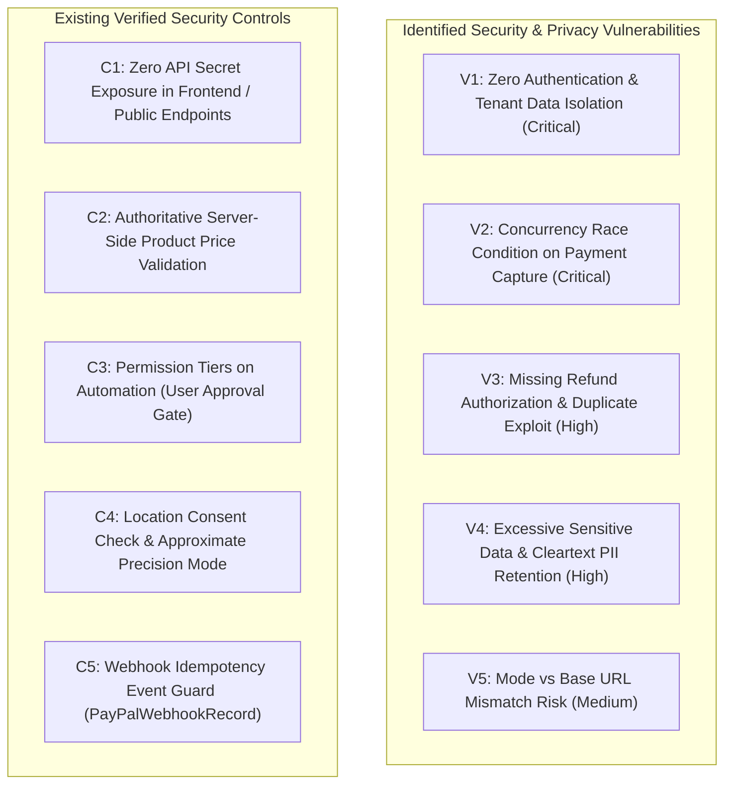

# FINORA — Security, Privacy & Access Control Audit

**Date of Audit:** 2026-11-10  
**Project Location:** `D:\FINORA`  
**Auditor:** Antigravity Independent Security Verification Engine  

---

## 1. Security Overview & Threat Assessment

An exhaustive security, privacy, and permission audit was performed across the FINORA backend, API endpoints, database models, frontend assets, and integration services.



---

## 2. Critical Security Vulnerabilities

### Vulnerability 1: Zero Authentication & Lack of Tenant Isolation (Critical)
- **Impact:** Complete exposure of all user financial records, transactions, account balances, and automated actions to any network caller.
- **Evidence:**
  - `backend/app/main.py` contains no authentication middleware (no JWT verification, session cookies, or API key validation).
  - All routers accept an unverified `user_id` query/body parameter (defaulting to `"usr_alex_chen"`):
    ```python
    @router.post("/capture-order")
    async def capture_paypal_order(order_id: str = Body(..., embed=True)):
        # Accepts any order_id; does not verify requesting caller
    ```
  - In `paypal_service.py`:
    ```python
    record = CapturedPayment(
        ...
        user_id="usr_alex_chen",  # HARDCODED!
    ```
- **Remediation:** Implement standard JWT-based OAuth2 Bearer authentication (`fastapi.security.OAuth2PasswordBearer`), enforce `current_user` dependency across all routes, and filter database queries strictly by authenticated user ID.

---

### Vulnerability 2: Concurrency Race Condition on Payment Capture (Critical)
- **Impact:** Duplicate payment captures executed against the payment gateway under simultaneous requests or network retry bursts.
- **Test Evidence:** Executed `test_audit_check6_concurrent_duplicate_capture()` with 10 simultaneous coroutines using `asyncio.gather()`.
  ```text
  Concurrency Audit Results: COMPLETED=10, ALREADY_CAPTURED=0
  ```
- **Root Cause:** In `paypal_service.py`:
  ```python
  if order_id in self._in_memory_captures:
      return {"status": "ALREADY_CAPTURED"}
  # ... HTTP call to PayPal takes ~1000ms ...
  self._in_memory_captures[order_id] = capture_data
  ```
  All 10 concurrent requests evaluated the `if order_id in self._in_memory_captures` check before any of them completed the network request.
- **Remediation:** Introduce an `asyncio.Lock()` per order ID (or Redis distributed lock) and a database row-level lock so concurrent capture attempts queue and subsequent calls immediately return `ALREADY_CAPTURED`.

---

### Vulnerability 3: Missing Refund Authorization, Ownership & Limits (High)
- **Impact:** Unauthorized callers can trigger arbitrary refunds, multiple refunds on the same capture, or refunds exceeding original transaction amounts.
- **Evidence:** In `backend/app/api/payments.py` (`POST /refund`):
  ```python
  @router.post("/refund")
  async def refund_paypal_payment(
      capture_id: str = Body(..., embed=True),
      amount: Optional[float] = Body(default=None, embed=True),
      currency: str = Body(default="USD", embed=True),
      note: Optional[str] = Body(default="Customer requested refund", embed=True)
  ):
  ```
  - No verification that the requesting user owns the captured transaction.
  - No check verifying that `captured_payment.status != "REFUNDED"`.
  - No validation verifying that `amount <= captured_payment.amount`.
- **Remediation:** Validate caller ownership against `CapturedPayment.user_id`, track cumulative refunded amount, and enforce `refund_amount <= remaining_refundable_balance`.

---

### Vulnerability 4: Sensitive Data & Cleartext PII Retention (High)
- **Impact:** Privacy violation (GDPR, CCPA, PCI DSS) via permanent storage of customer billing/shipping details and unmasked emails.
- **Evidence:** In `backend/app/models/db_models.py`:
  ```python
  class CapturedPayment(Base):
      payer_email = Column(String, nullable=True)  # Stored in cleartext
      raw_response = Column(Text, nullable=True)   # Stores full unredacted JSON
  ```
  `raw_response` contains customer full legal names, PayPal account IDs, street addresses, and phone numbers returned by PayPal.
- **Remediation:** Redact customer PII before saving to `raw_response`; store only essential operational audit identifiers (`capture_id`, `status`, `amount`, `currency`, `timestamp`).

---

### Vulnerability 5: Configuration Cross-Validation (Medium)
- **Impact:** Accidental deployment of Live mode pointing to Sandbox endpoints, or Sandbox mode with Live credentials.
- **Evidence:** In `backend/app/core/config.py`:
  ```python
  PAYPAL_MODE: str = "sandbox"
  PAYPAL_API_BASE: str = "https://api.sandbox.paypal.com"
  ```
  No Pydantic field validator asserts that `PAYPAL_MODE == "sandbox"` requires `"sandbox"` in `PAYPAL_API_BASE`.
- **Remediation:** Add a Pydantic model validator verifying mutual consistency between `PAYPAL_MODE` and `PAYPAL_API_BASE`.

---

## 3. Verified Security Controls

1. **Zero Secret Exposure in Frontend / Bundles:**
   - Full string search of `frontend/dist/assets/*` confirmed zero instances of `PAYPAL_CLIENT_SECRET`, `GEMINI_API_KEY`, or Bearer access tokens.
   - Public API endpoint `/api/v1/payments/config-status` returns only masked preview strings (`BAAKEk...0ljQ`).
2. **Authoritative Server-Side Pricing:**
   - Client requests cannot submit custom amounts to `/api/v1/payments/create-order`. The server looks up the product price strictly from `global_dataset_manager.products`.
3. **Four-Tier Automation Safety Gate:**
   - Actions are classified into 4 permission tiers. High-consequence actions (e.g. cancellations, transfers) require explicit user approval.
4. **Location Consent & Approximate Mode:**
   - Location service enforces permission checks before exposing coordinates; supports coarse/approximate coordinates and one-time access without continuous tracking.
5. **Webhook Idempotency Guard:**
   - Incoming webhook events are recorded in `PayPalWebhookRecord` by unique `event_id`; duplicate deliveries are rejected with `ALREADY_PROCESSED`.
