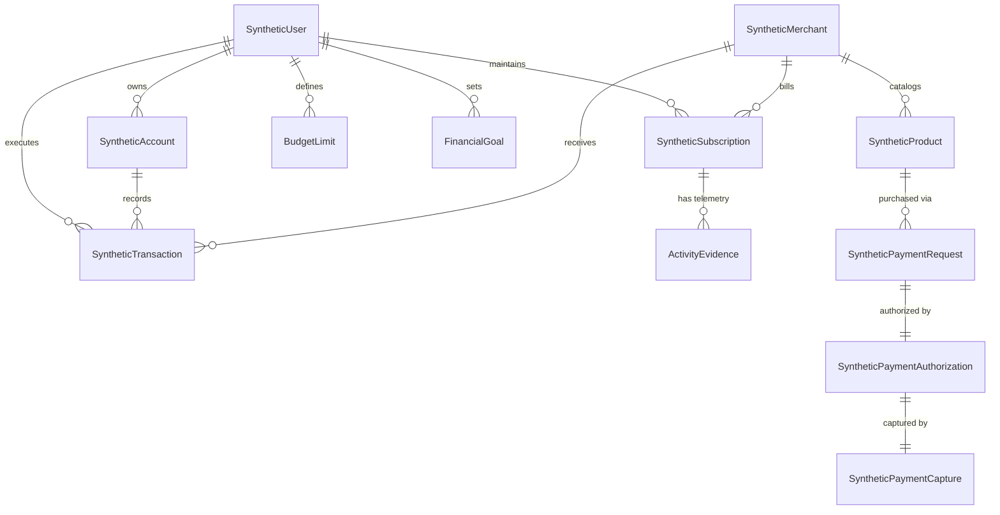

# FINORA — Database & Data Architecture Mapping
## Document 04: Relational Persistence, Synthetic Data Bank & Entity Relationships

---

## 1. Data Layer Topology: The Hybrid Architecture

FINORA employs a **hybrid data architecture** that cleanly separates foundational financial ledger simulation from persistent runtime mutations:

```
+---------------------------------------------------------------------------------------------------------+
|                                        DATA LAYER TOPOLOGY                                              |
+----------------------------------------------------+----------------------------------------------------+
                                                     |
                         +---------------------------+---------------------------+
                         |                                                       |
                         v                                                       v
+----------------------------------------------------+  +-------------------------------------------------+
|       RELATIONAL SQLITE STORE (finora.db)          |  |     IN-MEMORY SYNTHETIC DATA BANK               |
|  - Technology: SQLite 3 + SQLAlchemy 2.0 ORM       |  |  - Technology: Python In-Memory Class Registry  |
|  - Persistence: File on disk (backend/finora.db)   |  |  - Managed By: DatasetManager (seed=42)         |
|  - Purpose: Stateful runtime mutations             |  |  - Purpose: Authoritative financial ledgers     |
|                                                    |                                                    |
|  Tables:                                           |  Entities (Pydantic v2 Models):                   |
|  1. captured_payments                              |  1. SyntheticUser (3 personas)                    |
|  2. paypal_orders                                  |  2. SyntheticAccount (13 accounts)                |
|  3. connected_accounts                             |  3. SyntheticTransaction (347 transactions)       |
|  4. sync_logs                                      |  4. SyntheticMerchant (36 merchants)              |
|  5. user_preferences                               |  5. SyntheticProduct (105 products)               |
|                                                    |  6. SyntheticSubscription (12 subscriptions)      |
|                                                    |  7. ActivityEvidence (12 activity records)        |
|                                                    |  8. TestScenario (20 predefined scenarios)        |
|                                                    |  9. SyntheticBusiness & Invoice (2 B2B entities)  |
+----------------------------------------------------+  +-------------------------------------------------+
```

---

## 2. Relational SQLite Database Schema (`finora.db`)

The SQLite database contains 5 tables created via SQLAlchemy declarative models in [`backend/app/models/db_models.py`](file:///d:/FINORA/backend/app/models/db_models.py):

### 2.1 Table: `captured_payments`
Stores historical payment capture records generated via PayPal Sandbox or simulation.
- `id` (`VARCHAR`, Primary Key, indexed) — Internal UUID (e.g., `cap_67118a82`).
- `paypal_order_id` (`VARCHAR`, indexed, Not Null) — Corresponding PayPal Order ID.
- `paypal_capture_id` (`VARCHAR`, indexed, Nullable) — PayPal Sandbox Capture ID.
- `user_id` (`VARCHAR`, indexed, Not Null) — Identifier of the purchasing user.
- `product_id` (`VARCHAR`, Nullable) — Purchased product ID from catalog.
- `amount` (`FLOAT`, Not Null) — Landed order total captured.
- `currency` (`VARCHAR`, Default `"USD"`) — Monetary currency.
- `status` (`VARCHAR`, Not Null) — Status (`COMPLETED`, `PENDING`, `REFUNDED`).
- `payer_email` (`VARCHAR`, Nullable) — Email address of the PayPal payer.
- `payer_id` (`VARCHAR`, Nullable) — PayPal Payer Account ID.
- `raw_response` (`TEXT`, Nullable) — Serialized JSON response from PayPal API.
- `created_at` (`DATETIME`, Default `utcnow`) — Capture timestamp.
- `is_synthetic` (`BOOLEAN`, Default `True`) — Synthetic marker flag.

### 2.2 Table: `paypal_orders`
Tracks the creation and lifecycle of checkout orders before and after buyer approval.
- `order_id` (`VARCHAR`, Primary Key, indexed) — PayPal Order ID (e.g., `ORD-20261110-XXXX`).
- `user_id` (`VARCHAR`, indexed, Not Null) — User who initiated the checkout.
- `product_id` (`VARCHAR`, Not Null) — Authoritative product reference.
- `amount` (`FLOAT`, Not Null) — Order total calculated on backend.
- `currency` (`VARCHAR`, Default `"USD"`) — Currency code.
- `status` (`VARCHAR`, Default `"CREATED"`) — Status (`CREATED`, `APPROVED`, `CAPTURED`, `CANCELLED`).
- `approval_url` (`VARCHAR`, Nullable) — Buyer approval URL (`https://www.sandbox.paypal.com/checkoutnow?token=...`).
- `is_simulated` (`BOOLEAN`, Default `True`) — Indicates whether order was created via live Sandbox API or simulation.
- `created_at` (`DATETIME`, Default `utcnow`) — Order creation timestamp.
- `updated_at` (`DATETIME`, Default `utcnow`) — Last update timestamp.

### 2.3 Table: `connected_accounts`
Represents financial institution credentials linked via Open Banking / Plaid / PayPal.
- `id` (`VARCHAR`, Primary Key, indexed) — Connection ID (e.g., `conn_alex_chase`).
- `user_id` (`VARCHAR`, indexed, Not Null) — Owner persona ID.
- `institution_id` (`VARCHAR`, Not Null) — Institution identifier (e.g., `inst_chase`).
- `institution_name` (`VARCHAR`, Not Null) — Human-readable name (`Chase Bank`).
- `provider_type` (`VARCHAR`, Not Null) — `open_banking_plaid`, `paypal_direct`, `truelayer_uk`.
- `account_mask` (`VARCHAR`, Not Null) — Masked account number (`SYNTH-****-4921`).
- `account_type` (`VARCHAR`, Not Null) — Account type (`checking`, `savings`, `credit_card`).
- `connection_status` (`VARCHAR`, Default `"connected"`) — `connected`, `syncing`, `action_required`, `revoked`.
- `health_status` (`VARCHAR`, Default `"healthy"`) — `healthy`, `degraded`, `disconnected`.
- `last_sync_timestamp` (`DATETIME`, Default `utcnow`) — Last sync timestamp.
- `sync_frequency` (`VARCHAR`, Default `"hourly"`) — Polling frequency.
- `permissions_granted` (`TEXT`) — JSON array of scopes (`["read_transactions","read_balance"]`).
- `is_synthetic` (`BOOLEAN`, Default `True`) — Synthetic safety marker.

### 2.4 Table: `sync_logs`
Audit history of data synchronization jobs.
- `id` (`VARCHAR`, Primary Key, indexed) — Sync event UUID.
- `connection_id` (`VARCHAR`, indexed, Not Null) — Associated connected account.
- `user_id` (`VARCHAR`, indexed, Not Null) — User persona.
- `sync_type` (`VARCHAR`, Default `"automatic"`) — `automatic`, `manual_trigger`, `webhook`.
- `status` (`VARCHAR`, Default `"success"`) — `success`, `failed`, `partial`.
- `records_ingested` (`INTEGER`, Default `0`) — Ingested transaction count.
- `income_detected_count` (`INTEGER`, Default `0`) — Identified income count.
- `expenses_categorized_count` (`INTEGER`, Default `0`) — Categorized expense count.
- `duration_ms` (`INTEGER`, Default `120`) — Execution duration in milliseconds.
- `error_message` (`VARCHAR`, Nullable) — Error diagnostic if failed.
- `created_at` (`DATETIME`, Default `utcnow`) — Execution timestamp.

### 2.5 Table: `user_preferences`
User-level configuration overrides.
- `user_id` (`VARCHAR`, Primary Key, indexed) — User persona ID.
- `active_scenario_id` (`VARCHAR`, Default `"scen_01_normal_spending"`) — Active test scenario.
- `ai_provider` (`VARCHAR`, Default `"deterministic"`) — Active AI provider preference.
- `updated_at` (`DATETIME`, Default `utcnow`) — Modification timestamp.

---

## 3. In-Memory Synthetic Data Bank Entity Schema

Managed by `DatasetManager` in [`backend/app/demo_data/`](file:///d:/FINORA/backend/app/demo_data/), all financial figures use Python `Decimal` to eliminate binary floating-point drift:



### 3.1 Entity Specifications

1. **`SyntheticUser`**
   - Fields: `user_id`, `full_name`, `email`, `country`, `currency`, `employment_status`, `monthly_income`, `financial_goals`, `monthly_budgets`, `risk_preference`.
   - Seed Personas:
     - `usr_alex_chen`: Senior Software Engineer ($8,500/mo net income, $93k liquid assets).
     - `usr_sarah_jenkins`: Freelance Product Designer ($5,200/mo net income, variable cash flow).
     - `usr_marcus_vance`: Technology Executive ($14,000/mo net income, high discretionary commitments).

2. **`SyntheticAccount`**
   - Fields: `account_id`, `owner_id`, `account_name`, `account_type`, `currency`, `opening_balance`, `current_balance`, `credit_limit`, `account_status`, `account_number_mask`.
   - Invariant: `current_balance` is calculated deterministically by replaying all historical credits and debits from `opening_balance`.

3. **`SyntheticTransaction`**
   - Fields: `transaction_id`, `user_id`, `account_id`, `merchant_id`, `amount` (`Decimal`), `currency`, `transaction_type` (`income`, `expense`, `transfer`, `refund`, `fee`), `category`, `timestamp` (ISO 8601), `description`, `status`, `payment_method`, `anomaly_flag`.
   - Total Reconciled Records: 347 transactions across 12 calendar months.

4. **`SyntheticSubscription`**
   - Fields: `subscription_id`, `user_id`, `merchant_id`, `service_name`, `category`, `amount` (`Decimal`), `billing_frequency`, `next_billing_date`, `status`, `evidence_availability`, `suggested_action`, `potential_monthly_savings`.
   - Active Subscriptions for Alex Chen: 7 services totaling $291.97/mo.

5. **`ActivityEvidence`**
   - Fields: `evidence_id`, `subscription_id`, `source`, `evidence_state` (`confirmed_active`, `confirmed_low_usage`, `unverified_missing`, `contradictory`), `notes`.
   - Telemetry Sources: Downtown RFID turnstile badge logs, cloud API token telemetry, household fiber router traffic, contradictory flight ticket booking logs.

---

## 4. Referential Integrity & Financial Consistency

The integrity of the synthetic financial data bank is verified programmatically by [`backend/app/demo_data/validators.py`](file:///d:/FINORA/backend/app/demo_data/validators.py):

| Validation Check | Rule Enforced | Result |
| :--- | :--- | :--- |
| **Referential Integrity** | Every `user_id`, `account_id`, and `merchant_id` in transactions, subscriptions, and accounts resolves to a declared entity. | **100% Validated (0 orphaned foreign keys)** |
| **Balance Reconciliation** | For every account: $\text{Current Balance} = \text{Opening Balance} + \sum \text{Credits} - \sum \text{Debits}$. | **100% Validated (0 balance discrepancies)** |
| **Temporal Monotonicity**| Transaction timestamps are chronologically ordered without forward-dated entries. | **100% Validated** |
| **Synthetic Safety Markers**| Every single generated entity has `is_synthetic: true` and masked identifiers (`SYNTH-****-XXXX`). Real PII is strictly absent. | **100% Validated** |
| **Decimal Precision** | Zero binary floating-point drift across all monetary totals. | **100% Validated** |
