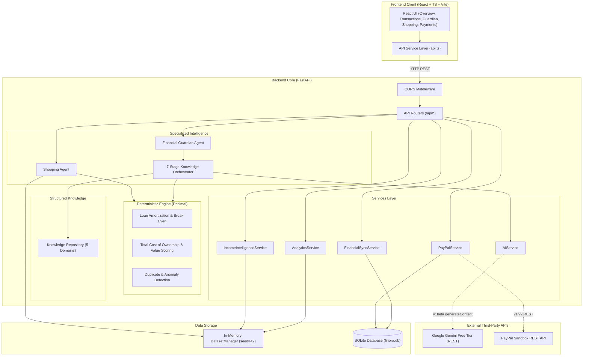
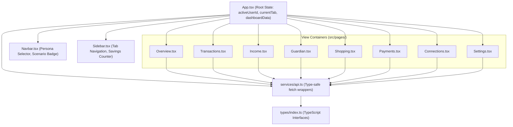
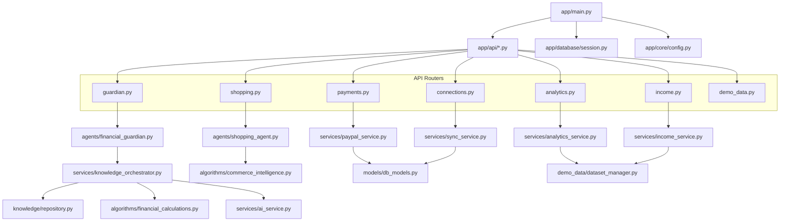
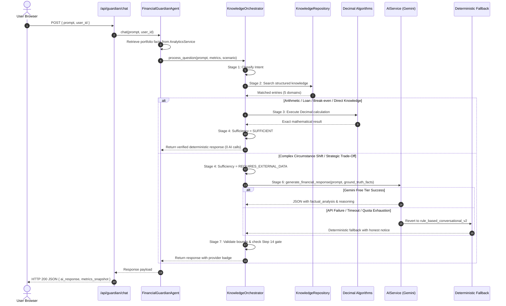
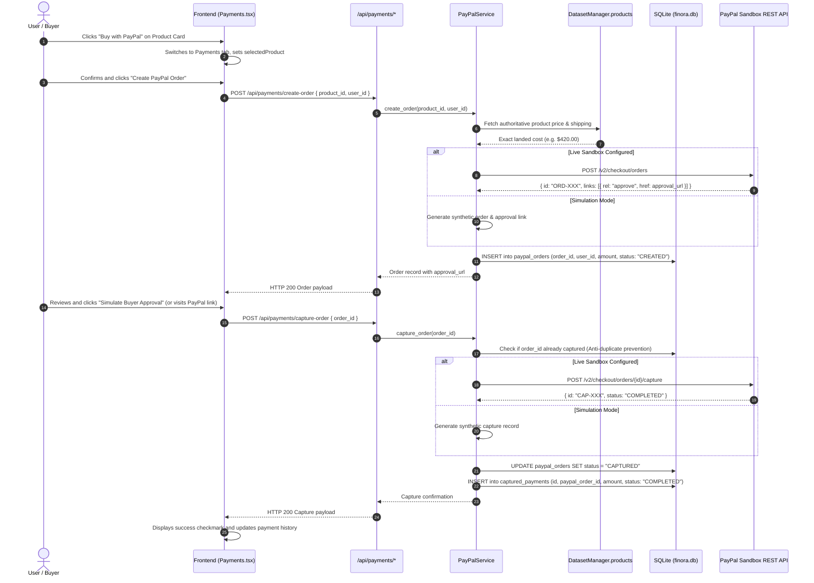

# FINORA — System Dependency & Process Flow Maps
## Document 10: Architectural Dependencies, Diagrams & Critical Flows

---

## 1. Overall System Architecture Diagram

---

## 2. Frontend Component Dependency Diagram

---

## 3. Backend Module Dependency Diagram

---

## 4. AI Request & Decision Flow Diagram

---

## 5. PayPal Payment Execution Flow Diagram

---

## 6. Coupling & Dependency Analysis

1. **Clean Separation of Concerns:**
   - Algorithms in `app/algorithms/` have **zero** dependencies on external libraries or databases. They depend only on Python's built-in `decimal` and `math` modules.
   - Knowledge entries in `app/knowledge/` are pure data structures with zero framework dependencies.
2. **Circular Dependencies:**
   - **None.** Codebase imports follow a strict downward hierarchy: API $\rightarrow$ Agents $\rightarrow$ Services $\rightarrow$ Algorithms / Models.
3. **Single Points of Failure:**
   - `DatasetManager` instance is a process-global singleton (`global_dataset_manager`). In-memory mutations persist for the server process lifetime. Restarting the server resets in-memory data to seed state.
   - SQLite file `finora.db` operates in single-file mode. Concurrent write operations are locked by SQLite, which is suitable for prototype development but would require PostgreSQL for multi-user production.
